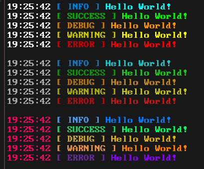

    

# VibrantLogs

**VibrantLogs** is a simple logging library in C with colored terminal output and customizable color schemes.

## Features

- Colored terminal output
- Fully customizable RGB colors
- Multiple log levels
- Delayed log messages
- Coordination with Timey library to schedule messages using timestamps and datetimes
- The ability to either log to the console or to a file

*Here is an example of some logs using different color schemes in a terminal:*

    

> [!NOTE]
> VibrantLogs is not thread-safe as of right now.

## Documentation and Information

Please refer to the VibrantLogs documentation <a href="docs/html">here</a>.
